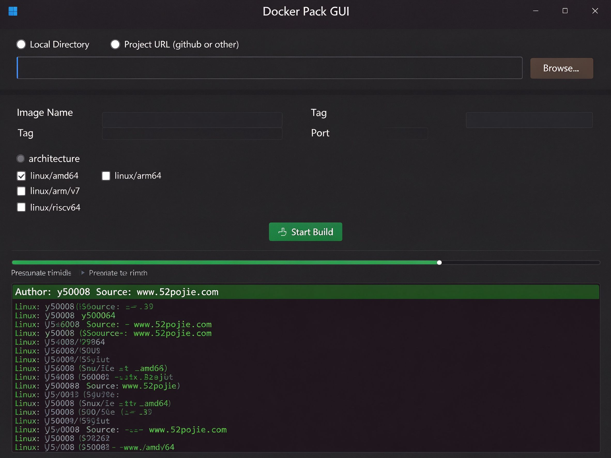

<div align="center">

# 🐳 Docker Pack GUI

**一键将项目源码打包成 Docker 镜像的可视化工具**

作者：y50008 ｜ 来源：www.52pojie.com ｜ 开源地址：https://github.com/y50008/docker-pack


</div>

---

## 📖 项目简介

Docker Pack GUI 是一款 **Windows 桌面端**的 Docker 镜像打包工具。你只需要选择项目源码目录（或输入 Git 仓库地址），点击「开始打包」，工具会自动识别项目语言、生成多阶段 Dockerfile、调用 Docker 构建镜像，并最终导出为 `.tar` 文件供你下载保存。

**无需手写 Dockerfile，无需记 docker build 命令，小白也能打出生产级镜像。**



---

## ✨ 核心特性

| 特性 | 说明 |
|---|---|
| 🎯 **自动识别项目类型** | 支持 13 种主流语言/框架，无需手动配置 |
| 🎨 **可视化界面** | 原生 Windows GUI，双击 exe 即用，无需安装 Python |
| 🌐 **支持 Git 仓库** | 直接输入 GitHub/Gitee 地址，自动 clone 后打包 |
| 🏗️ **多架构构建** | 支持 amd64 / arm64 / armv7 / riscv64 任意组合 |
| ⏱️ **实时进度** | 进度条 + 已用时 + 预计剩余时间 + 实时日志 |
| 📦 **一键导出 tar** | 构建完成后点下载，选择保存位置即可 |
| 🇨🇳 **国内镜像源** | npm / pip / Go proxy 默认切国内源，构建更快 |
| 📦 **多阶段构建** | 自动生成精简镜像，体积最小化 |

---

## 🚀 快速开始

### 环境要求

- Windows 10 / 11
- 已安装并启动 [Docker Desktop](https://www.docker.com/products/docker-desktop/)
- 如需打包 Git 仓库，本机需安装 [Git](https://git-scm.com/)

### 使用步骤

1. **下载 `DockerPack.exe`**（在 [Releases](../../releases) 页面）
2. **双击运行**，无需安装
3. **选择源码来源**：
   - 📁 本地目录：点「浏览...」选择项目文件夹
   - 🌐 项目地址：输入 GitHub/Gitee 仓库 URL
4. **配置镜像**：镜像名、标签（tag）、暴露端口
5. **选择目标架构**：默认 amd64，需要 ARM 服务器就勾选 arm64
6. **点击「开始打包」**，观察实时日志和进度
7. **打包完成后点「下载打包好的镜像文件」**，选择保存位置

---

## 🗂️ 支持的项目类型

| 标志文件 | 识别为 | 基础镜像策略 |
|---|---|---|
| `Dockerfile`（已有） | 项目自带 Dockerfile | **直接复用，不覆盖** |
| `package.json` | Node.js（含 TS/React/Vue/Next） | node:20-alpine 多阶段 |
| `requirements.txt` / `pyproject.toml` | Python | python:3.11-slim 多阶段 |
| `pom.xml` | Java Maven | maven:3.9 + JRE 21 |
| `build.gradle` | Java Gradle / Spring Boot | gradle:8 + JRE 21 |
| `go.mod` | Go | golang:1.22 + alpine |
| `*.csproj` / `*.sln` | .NET | dotnet/sdk:8 + aspnet:8 |
| `composer.json` | PHP | composer:2 + php:8.3-apache |
| `Gemfile` | Ruby | ruby:3.2-alpine |
| `Cargo.toml` | Rust | rust:1.77-alpine + musl |
| `CMakeLists.txt` | C/C++ | gcc:13 + cmake |
| `pubspec.yaml` | Flutter Web | Flutter SDK + nginx |
| `index.html`（兜底） | 静态网站 | nginx:alpine |

> 💡 **智能兼容**：如果项目根目录已经有 Dockerfile，工具会直接使用它，不会覆盖你写好的配置。

---

## 🏗️ 目标架构说明

| 架构 | 适用场景 |
|---|---|
| `linux/amd64` | 普通 PC、绝大多数云服务器（x86_64）✅ 默认 |
| `linux/arm64` | AWS Graviton、Apple M 系列、阿里云 ARM、树莓派 5 |
| `linux/arm/v7` | 32 位 ARM：树莓派 3/4 老系统、IoT 设备 |
| `linux/riscv64` | RISC-V 开发板、边缘计算 |
| **全部** | 一次打 4 种架构（QEMU 模拟，较慢） |

> ⚠️ 在 Windows 上打 ARM 架构镜像会走 QEMU 模拟，速度比原生 amd64 慢 5-10 倍，属于正常现象。

---

## 📦 产物使用

打包完成后你会得到一个 `.tar` 文件，在目标服务器上导入：

```bash
# 导入镜像
docker load -i my-app_v1.0.tar

# 查看镜像
docker images

# 运行容器（注意端口映射要和你填的端口一致）
docker run -d -p 8080:8080 my-app:v1.0

# 浏览器访问
http://服务器IP:8080
```

---

## 🛠️ 从源码运行

```bash
# 克隆仓库
git clone https://github.com/y50008/docker-pack.git
cd docker-pack-gui

# 直接运行（需要 Python 3.10+）
python pack_gui.py
```

### 打包成 exe

```bash
pip install pyinstaller
pyinstaller --onefile --windowed --name DockerPack pack_gui.py
```

生成的 exe 在 `dist/DockerPack.exe`。

---

## 📁 项目结构

```
docker-pack-gui/
├── pack_gui.py      # tkinter GUI 主程序
├── core.py          # 核心逻辑：项目检测、Dockerfile 生成、git clone、docker build/save
├── README.md        # 本文件
├── .gitignore
└── dist/
    └── DockerPack.exe   # 打包好的可执行程序
```

---

## 📝 License

本项目仅供学习交流使用，转载请注明出处。

作者：**y50008** ｜ 来源：**www.52pojie.com**
